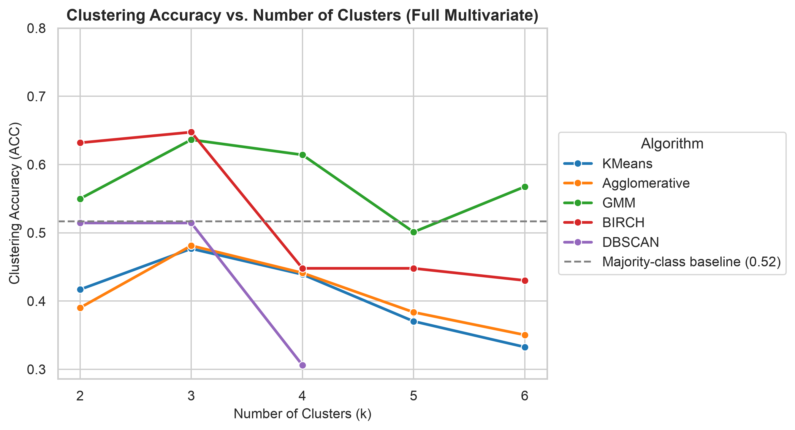
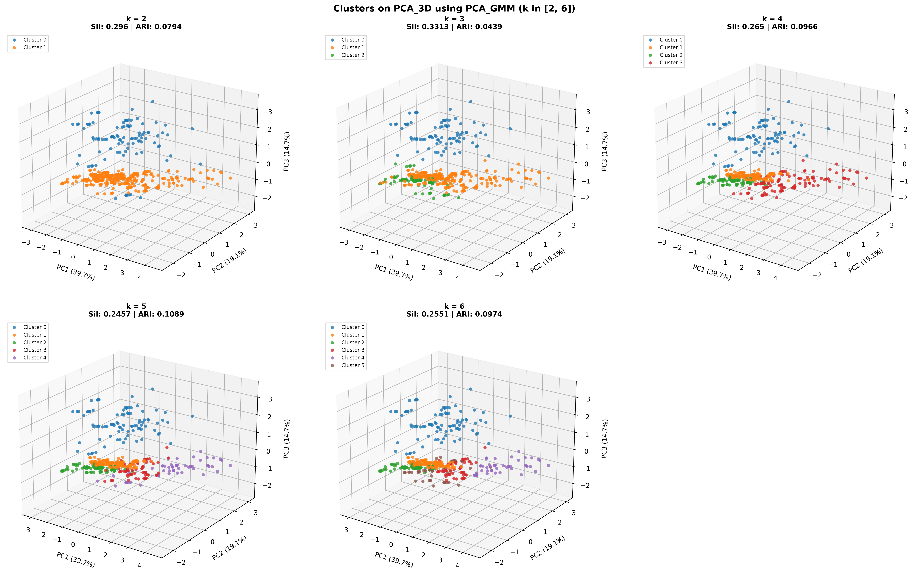

# Clustering Patient Health Patterns

Unsupervised clustering of maternal health vital signs. This project compares five clustering algorithms across several feature subsets and PCA projections, then checks how well the discovered clusters line up with the dataset's known risk levels.

## Overview

The question: **do natural groupings in patients' vital signs correspond to clinical risk levels?**

The risk labels are never used to build the clusters. They are only used afterwards to evaluate them. The project:

- preprocesses and standardizes the data,
- clusters it with KMeans, Agglomerative, GMM, BIRCH and DBSCAN,
- repeats the analysis on single vital signs, related groups of vital signs and the full feature set,
- repeats it again in 2D and 3D PCA space,
- scores every run with internal and external metrics and saves tables and figures.

## Dataset

The Maternal Health Risk dataset (UCI Machine Learning Repository): 1,014 records, six features and a three-level label.

| Feature | Description |
|---|---|
| `Age` | Age in years |
| `SystolicBP` / `DiastolicBP` | Blood pressure (mmHg) |
| `BS` | Blood sugar level |
| `BodyTemp` | Body temperature (F) |
| `HeartRate` | Resting heart rate (bpm) |
| `RiskLevel` | Label: low risk (406), mid risk (336), high risk (272). Used for evaluation only |

The file is included at `data/raw/Maternal Health Risk Data Set.csv`.

## Methods

### Preprocessing (`src/preprocessing.py`)

1. **Remove exact duplicate rows:** 562 of the 1,014 rows are duplicates, leaving 452.
2. **Remove implausible heart rates:** rows with `HeartRate <= 40` are dropped (one row), leaving 451.
3. **Standardize** all six features with `StandardScaler`.

The cleaning lives in a single function, `clean_data()`, so the clustering and the evaluation always use exactly the same rows.

### Feature subsets

| Subset | Features |
|---|---|
| `univariate_bp`, `univariate_bs`, `univariate_hr` | `SystolicBP`, `BS`, `HeartRate` alone |
| `cardiovascular` | `SystolicBP`, `DiastolicBP`, `HeartRate` |
| `metabolic` | `BS`, `Age` |
| `full_multivariate` | All six features |

### Algorithms

| Algorithm | Notes |
|---|---|
| KMeans (k-means++) | k = 2 to 6 |
| Agglomerative | Ward linkage, k = 2 to 6 |
| Gaussian Mixture (GMM) | Full covariance, k = 2 to 6 |
| BIRCH | k = 2 to 6. If the default threshold finds fewer than k subclusters, the threshold is halved until exactly k clusters are produced |
| DBSCAN | Finds its own number of clusters, so it runs over an `eps` and `min_samples` grid instead of a k sweep. Points labeled noise (-1) are kept in the results |

The same algorithms are also run on 2D and 3D PCA projections of the full standardized data.

### Evaluation

| Metric | What it measures |
|---|---|
| Silhouette, Davies-Bouldin, Calinski-Harabasz | Internal cluster quality (no labels). Only compare these between runs on the same feature set |
| Adjusted Rand Index (ARI), Normalized Mutual Information (NMI) | Agreement with the true risk levels, adjusted for chance and comparable across k |
| Accuracy | Strict one-to-one matching of clusters to risk levels (Hungarian algorithm). Extra clusters and DBSCAN noise points count as errors, so it cannot rise just because k grows |
| Purity | Each cluster credited with its most common class. Saved for reference only. It always increases with k, so don't use it to compare different k |
| Majority-class baseline | 0.517, the accuracy of always guessing "low risk" |

Results are ranked by ARI, then NMI.

## Getting started

Requires Python 3 (developed with 3.13).

```bash
git clone https://github.com/AndrewHerman28/CMPSC446_ClusteringPatientHealthPatterns-.git
cd CMPSC446_ClusteringPatientHealthPatterns-
pip install -r requirements.txt
python main.py
```

`main.py` runs the whole pipeline in order and takes about 20 seconds:

1. Check the raw data
2. Preprocess, cluster and run PCA
3. Compute accuracy and purity
4. Save per-algorithm cluster figures
5. Save PCA cluster figures (2D and 3D)
6. Save the accuracy comparison figure

Options:

```bash
python main.py --show           # also display each figure in a window
python main.py --skip-figures   # stop after the CSV results and accuracy report
```

Run it from any location. All paths are resolved relative to the project folder.

## Project structure

```
main.py                      # runs the full pipeline
requirements.txt
data/
  raw/                       # original dataset
  processed/                 # generated results (CSV)
    individual_models/       # one results file per algorithm
    master_results.csv       # all algorithms in one table
    pca_results.csv          # clustering results in PCA space
    pca_base_coords.csv      # PC1-PC3 coordinates used for plots
    pca_explained_variance.csv
    y_true.csv               # true risk levels, row-aligned with every label list
figures/                     # generated figures
src/
  paths.py                   # all file locations
  preprocessing.py           # cleaning, scaling, PCA coordinates
  run_and_save_results.py    # runs every algorithm and saves results
  PCA.py                     # clustering in 2D / 3D PCA space
  algorithms/                # kmeans, agglomerative, gmm, birch, dbscan
  evaluation/
    clustering_accuracy.py   # accuracy, purity, majority baseline
  visualization/             # cluster, PCA (2D/3D) and accuracy figures
```

## Outputs

- **`data/processed/master_results.csv`** has one row per run (algorithm, feature subset, k) with all metrics, plus the cluster label of every patient.
- **`figures/clusters/algorithm_clusters/`** has the full-multivariate clusters for each algorithm, for k = 2 to 6, projected onto PC1 and PC2.
- **`figures/clusters/pca_clusters/2D` and `3D/`** have the clusters found in PCA space for each algorithm.
- **`figures/multivariate_accuracy_comparison.png`** compares accuracy across algorithms and k, with the majority-class baseline.

Cluster labels are stored as JSON lists, in the same row order as `y_true.csv`.





## Key findings

On the full feature set (451 patients):

- **Clusters match risk levels only weakly.** The best ARI is 0.30 (BIRCH, k = 3), followed by GMM (0.29 at k = 4, 0.28 at k = 3) and DBSCAN (0.29 at k = 8, with 23% of points labeled noise).
- **k = 3 is the sweet spot.** Strict accuracy peaks at three clusters for most algorithms, matching the three risk levels. It then generally falls as k grows, which is expected because extra clusters can't be matched to a class.
- **Accuracy is only modestly above guessing.** The best accuracy is 0.65 (BIRCH, k = 3), against a majority-class baseline of 0.52.
- **PCA is informative but lossy.** PC1 to PC3 explain 39.7%, 19.1% and 14.7% of the variance (59% for two components, 73.5% for three).

## Notes and limitations

- **Silhouette is not comparable across feature sets.** Single, discrete features such as heart rate score very high on Silhouette (about 0.85) despite barely relating to risk level (ARI close to 0.02), which is why runs are ranked by ARI.
- **Deduplication is an assumption.** More than half the rows were exact duplicates, and with no patient ID there is no way to prove they are artifacts and not real patients with identical readings. In an exploratory check outside the pipeline, results without deduplication gave a lower ARI for the best configurations (BIRCH at k = 3 dropped from 0.30 to 0.15), so treat the exact scores with caution. The general pattern, weak agreement with risk level, held either way.
- **Features are coarse.** `BodyTemp` is 98.0 for most patients, so the few higher values weigh heavily after scaling. `SystolicBP` and `DiastolicBP` are strongly correlated (0.79).
- **DBSCAN needs settings tuned per feature space.** Its cluster count depends on `eps` and `min_samples`, so for each k the plots and the accuracy comparison show its best run by ARI. Only runs with 2 to 6 clusters appear in the figures.
- **Results are regenerated on every run.** Running a single step on its own (for example `run_and_save_results.py`) clears the accuracy columns, so use `main.py`.
